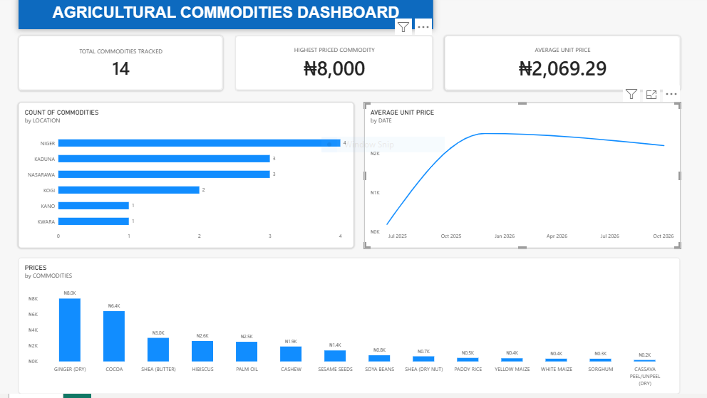

# 🌾 Nigerian Agricultural Commodities ETL & Analytics Pipeline

An end-to-end automated **ETL (Extract, Transform, Load)** data pipeline and interactive **Power BI** dashboard that scrapes live agricultural market watch data from the **Lagos Commodities and Futures Exchange (LCFE)**, stores it in **Microsoft SQL Server**, and visualizes commodity pricing trends across Nigerian states.

---

## 📌 Project Overview

Tracking agricultural commodity prices manually across multiple Nigerian states is time-consuming and prone to inconsistencies. This project automates the entire workflow—from extracting live web market data to cleaning, loading into a relational database, and generating an executive Power BI report for faster market comparison.

### Architecture & Workflow
`LCFE Market Watch (Web)` ➔ `Python (Extract & Transform)` ➔ `Microsoft SQL Server (Load)` ➔ `Power BI (Model & Visualize)`

---

## 🛠️ Tech Stack

* **Extraction & Transformation:** Python (`Requests`, `BeautifulSoup4`, `Pandas`)
* **Database & Loading:** Microsoft SQL Server (`SQLAlchemy`, `pymssql`)
* **Data Modeling & Visualization:** Power BI Desktop, Power Query (M)

---

## 🔍 Key Features

1. **Automated Web Scraping (`scraper.py`):**
   * Extracts commodity names, locations, measurement units, dates, and unit prices from the LCFE Market Data portal.
   * Implements custom request headers and error handling for reliable extraction.
2. **Data Cleaning & Transformation:**
   * Standardizes `DD/MM/YYYY` strings into SQL-ready date formats.
   * Strips formatting characters (commas, range delimiters) to convert unit prices into clean numeric values (`price_ngn`).
   * Appends extraction timestamps (`scraped_at`) for auditability.
3. **Structured Storage in SQL Server:**
   * Automatically creates/updates the `agric_data` table inside SQL Server and exports a local CSV backup (`lcfe_agric_data.csv`).
4. **Interactive Power BI Dashboard:**
   * Splits multi-state entries (e.g., `NIGER/NASARAWA/KEBBI`) into normalized rows in Power Query for accurate state-by-state commodity counts.
   * Compares unit prices across commodities and tracks historical price movements.

---

## 📊 Key Market Insights

* **High-Value Cash Crops:** **Dry Ginger (₦8,000/kg)** and **Cocoa (₦6,400/kg)** command the highest unit prices among tracked commodities.
* **Staple Grains:** **Sorghum (₦345/kg)** and **White Maize (₦350/kg)** represent the most affordable staples per kilogram.
* **Regional Supply Hubs:** **Niger** and **Nasarawa** states appear most frequently as primary sourcing locations across multiple agricultural commodities.

---

## 🖼️ Dashboard Preview



*(Tip: Replace `dashboard_preview.png` with the filename of your exported Power BI screenshot.)*

---

## 🚀 How to Run This Project Locally

### 1. Clone the Repository
```bash
git clone https://github.com
cd lcfe-commodity-etl-pipeline
```

### 2. Install Dependencies
```bash
pip install requests beautifulsoup4 pandas sqlalchemy pymssql
```

### 3. Configure Database Connection
Set your SQL Server connection URI as an environment variable (or update the fallback string in `scraper.py`):
```bash
export DB_URI="mssql+pymssql://127.0.0.1/iswipe_cohort_3b"
```

### 4. Run the Pipeline
```bash
python scraper.py
```

### 5. Refresh Power BI
Open `agric_commodities_dashboard.pbix` in **Power BI Desktop** and click **Refresh** to load the latest SQL Server records.

---

## 🔮 Future Improvements

* Expand the scraper to ingest the **Solid Minerals** market table on LCFE.
* Schedule automated daily runs using **Windows Task Scheduler** or **GitHub Actions** to build a historical time-series dataset.
* Implement incremental loading (`if_exists='append'` with deduplication) instead of full table replacement to preserve daily price fluctuations.

---

## 👤 Author

**Ifeduba Amarachi Vincent**  
Data Analyst & Technical Trainer | Python • SQL • Power BI • Excel  
* [LinkedIn]([https://linkedin.com/in/ifeduba-amarachi)  
* [GitHub](https://github.com)
